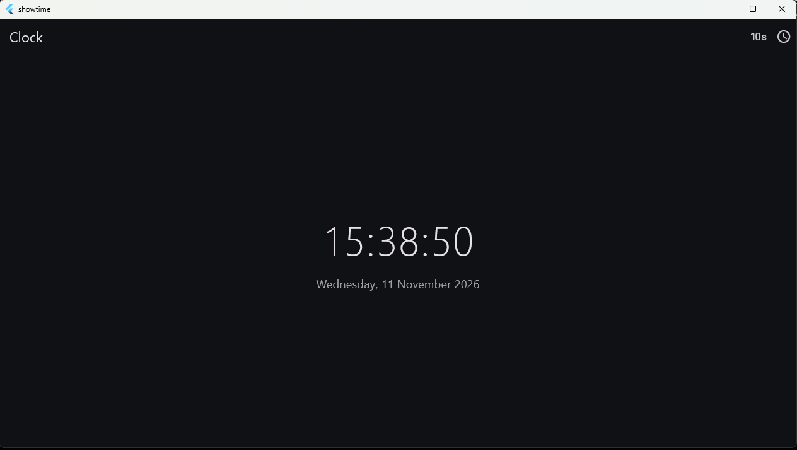
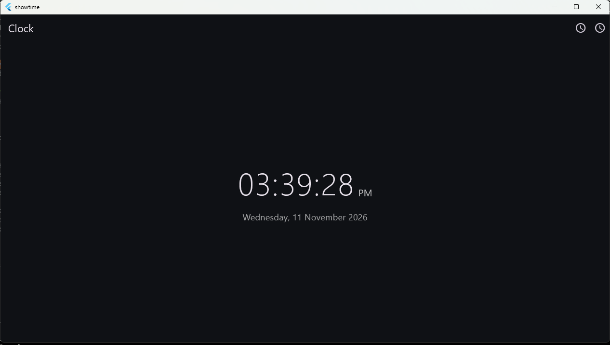
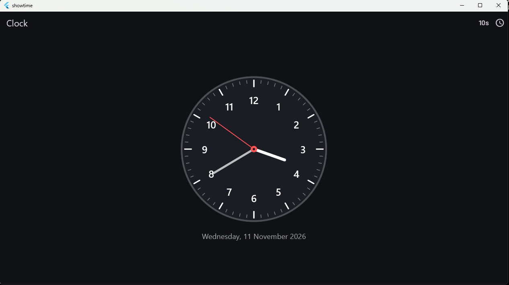

# showtime

# Clock App

A minimal, dark-themed clock built with Flutter. It shows the current time as either a digital or a hand-drawn analog clock, with a 12/24-hour toggle and an animated transition between the two views.

## Features

* **Digital clock** with tabular figures, so the digits don't jump around as they change
* **Analog clock** drawn entirely with `CustomPainter`: face, 60 tick marks, hour numerals, and hour, minute and second hands
* **12/24-hour format** toggle, with an AM/PM indicator in 12-hour mode
* **Full date display** (e.g. `Wednesday, 11 November 2026`) under both clock styles
* **Animated switching** between digital and analog using `AnimatedSwitcher`
* **Material 3 dark theme** with a custom background (`#0F1115`)
* Updates every second via `Timer.periodic`, cancelled cleanly on dispose

## Screenshots


Digital - 24H




Digital:12H




Analogue:



## Getting Started

### Prerequisites

* [Flutter SDK](https://docs.flutter.dev/get-started/install) (Dart 3+, since the code uses super-parameters such as `super.key`)
* An emulator, simulator, physical device, or a browser/desktop target enabled in Flutter

Verify your setup:

```bash
flutter doctor
```

### Installation

1. Create a Flutter project (skip if you already have one):
   ```bash
   flutter create clock_app
   cd clock_app
   ```
2. Replace `lib/main.dart` with the `main.dart` from this repository.
3. Add the `intl` dependency:
   ```bash
   flutter pub add intl
   ```
4. Fetch packages:
   ```bash
   flutter pub get
   ```

### Run

```bash
flutter run
```

To target a specific platform:

```bash
flutter run -d chrome     # Web
flutter run -d windows    # Windows
flutter run -d macos      # macOS
flutter run -d <device>   # Connected device or emulator
```

## Usage

Two icon buttons sit in the app bar:


| Button                | Action                                                                    |
| --------------------- | ------------------------------------------------------------------------- |
| Timer / clock icon    | Switch between**24-hour**and**12-hour**format (affects the digital clock) |
| Schedule / watch icon | Switch between**digital**and**analog**display                             |

## Project Structure

Everything lives in a single file, `lib/main.dart`:


| Component       | Description                                                                            |
| --------------- | -------------------------------------------------------------------------------------- |
| `ClockApp`      | Root`MaterialApp`; sets the dark Material 3 theme                                      |
| `ClockScreen`   | Stateful screen that owns the timer and the display settings (`_isAnalog`,`_is24Hour`) |
| `DigitalClock`  | Renders the time, optional AM/PM, and the date                                         |
| `AnalogClock`   | Sizes the clock face (85% of screen width, max 360 px) and shows the date below it     |
| `_ClockPainter` | `CustomPainter`that draws the face, ticks, numbers, hands, and center cap              |

## How It Works

* `ClockScreen` stores the current `DateTime` and refreshes it every second with `Timer.periodic`.
* The analog hands use smooth angles: the minute hand advances with seconds, and the hour hand advances with minutes.
* Angles are converted to coordinates with `sin(angle)` and `-cos(angle)`, so 0° points to 12 o'clock and rotation runs clockwise.
* `shouldRepaint` only returns `true` when the second changes, which avoids unnecessary repaints.

## Dependencies


| Package                                 | Purpose                                  |
| --------------------------------------- | ---------------------------------------- |
| `flutter`                               | UI framework                             |
| [`intl`](https://pub.dev/packages/intl) | Time and date formatting via`DateFormat` |

## Customization Ideas

* Change the theme colors in `ClockApp` (`scaffoldBackgroundColor`) or the hand colors in `_ClockPainter`
* Adjust the maximum analog clock size in `AnalogClock`
* Extend with time zones, an alarm, a stopwatch, or persisted settings (e.g. with `shared_preferences`)

## License

Add your preferred license here (e.g. MIT).

A new Flutter project.

## Getting Started

This project is a starting point for a Flutter application.

A few resources to get you started if this is your first Flutter project:

- [Learn Flutter](https://docs.flutter.dev/get-started/learn-flutter)
- [Write your first Flutter app](https://docs.flutter.dev/get-started/codelab)
- [Flutter learning resources](https://docs.flutter.dev/reference/learning-resources)

For help getting started with Flutter development, view the
[online documentation](https://docs.flutter.dev/), which offers tutorials,
samples, guidance on mobile development, and a full API reference.
